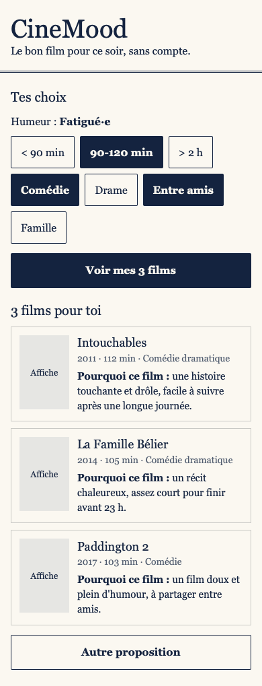
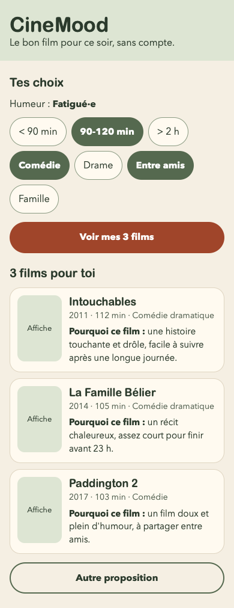
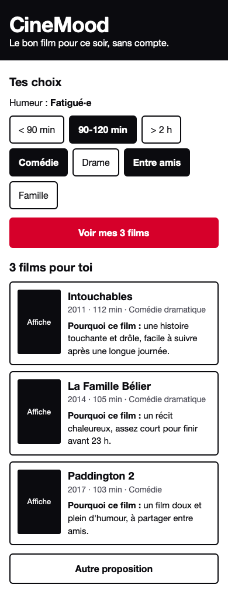

# Propositions de design · CineMood

Trois directions visuelles générées avec l'IA à partir du [brief](../../../brief.md), du [persona](../persona.md) et du [user flow](../user-flow.md). Chacune est archivée en image (écran 2 à 390 px) et en page HTML.

| Proposition | Image | Page |
|---|---|---|
| A · Éditoriale | [piste-a-editoriale.png](piste-a-editoriale.png) | [piste-a-editoriale/index.html](piste-a-editoriale/index.html) |
| B · Chaleureuse | [piste-b-chaleureuse.png](piste-b-chaleureuse.png) | [piste-b-chaleureuse/index.html](piste-b-chaleureuse/index.html) |
| C · Moderne | [piste-c-moderne.png](piste-c-moderne.png) | [piste-c-moderne/index.html](piste-c-moderne/index.html) |

## Organisation des fichiers

- `commun/base.css` : la mise en page partagée par les 3 propositions.
- `piste-a-editoriale/`, `piste-b-chaleureuse/`, `piste-c-moderne/` : `index.html` et le `style.css` propre à chaque direction.

Les 3 propositions ont le même HTML et ne diffèrent que par les variables CSS de leur `style.css`. La [critique](../critique.md) compare donc uniquement la direction visuelle.

La direction retenue (Piste B avec les contours de la Piste C) est appliquée dans la [maquette](../maquette/index.html).

## Données

Les films sont des exemples choisis pour la maquette. Les affiches sont remplacées par des cadres vides.
