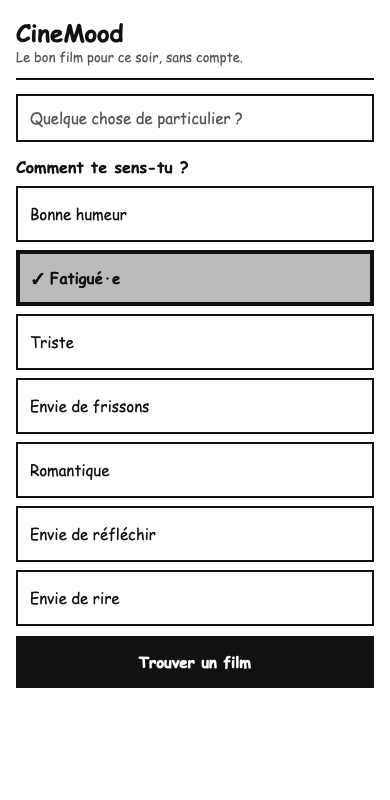
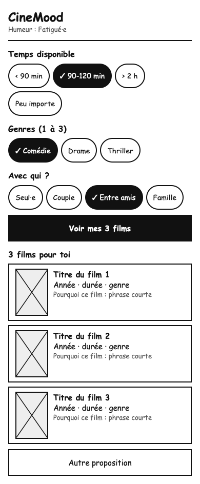
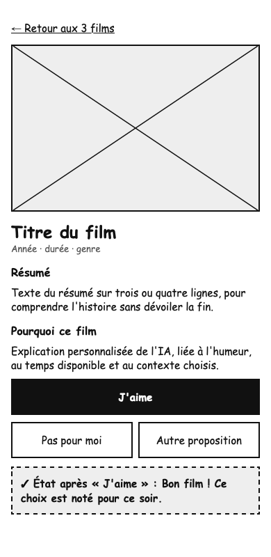

# Wireframes · CineMood

Wireframes basse fidélité des 3 écrans du [user flow](../user-flow.md), en niveaux de gris, à la largeur de référence de 390 px. Les sources HTML sont dans [sources/](sources/).

## 1 · Accueil et humeur

1. Champ facultatif « Quelque chose de particulier ? » en haut de l'écran.
2. Cartes d'humeur en une seule colonne, d'au moins 48 px de haut. La carte choisie est grisée et cochée.
3. Bouton principal « Trouver un film » en bas, à portée du pouce.

## 2 · Filtres et résultats

1. Rappel de l'humeur choisie sous le titre.
2. Puces de durée, de genre et de contexte ; les puces actives sont noires et cochées.
3. Bouton « Voir mes 3 films », puis 3 cartes avec une affiche, l'année, la durée, le genre et une phrase « Pourquoi ce film ».
4. Bouton « Autre proposition » sous les résultats.

## 3 · Fiche film

1. Lien « Retour aux 3 films » en haut.
2. Grande affiche, titre, année, durée et genre.
3. Résumé, puis la section « Pourquoi ce film ».
4. Bouton principal « J'aime », puis « Pas pour moi » et « Autre proposition ».
5. Confirmation affichée après « J'aime ».
